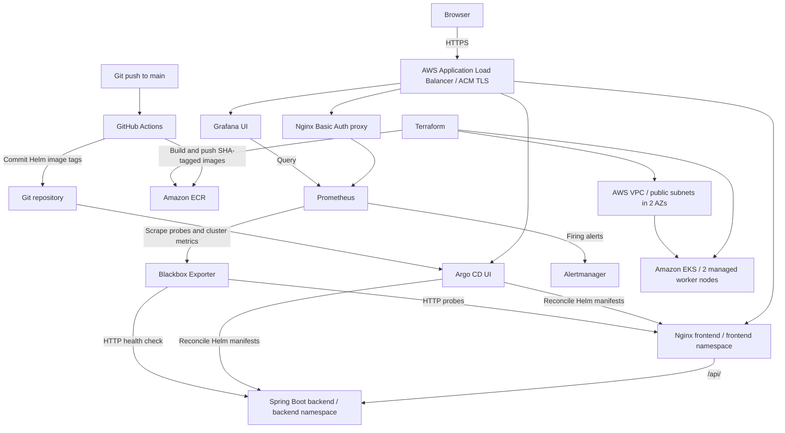

# k8s-demo — AWS EKS DevOps Reference Project

An end-to-end, **proof-of-concept** deployment of a two-tier web application on Amazon EKS. The project demonstrates infrastructure as code, container delivery, GitOps, Kubernetes security controls, monitoring, and incident detection. Built as a practical DevOps engineering demonstration; **not a production-ready platform**.

## Technology stack

| Layer | Implementation |
| --- | --- |
| Infrastructure | Terraform, AWS VPC, Amazon EKS, IAM, Amazon ECR |
| Kubernetes | EKS 1.36, managed node group, Helm, Deployments, ClusterIP Services, Ingress |
| Applications | Nginx frontend (port 8081), Spring Boot backend (port 8080) |
| Traffic | AWS Load Balancer Controller, shared Application Load Balancer, ACM TLS |
| CI | GitHub Actions, Docker, immutable SHA image tags, ECR |
| GitOps | Argo CD (frontend, backend, platform applications) |
| Security | Kubernetes RBAC, ServiceAccounts, NetworkPolicies, HTTPS, Basic Auth for Prometheus |
| Observability | kube-prometheus-stack, Grafana, Prometheus, Blackbox Exporter, Alertmanager |

## Architecture



The diagram is conceptual: frontend-to-backend communication is via Kubernetes Services; Blackbox probes are performed from inside the cluster. Public access is provided only for the configured UI endpoints.

## Infrastructure

Terraform in [`terraform/`](terraform/) provisions:

- VPC `10.20.0.0/16`, two public subnets (`10.20.1.0/24`, `10.20.2.0/24`) across availability zones, internet gateway and routing.
- EKS cluster `k8s-demo-eks` in `eu-north-1`, Kubernetes version `1.36` as configured in Terraform.
- Managed node group with **two `c7i-flex.large` On-Demand nodes**.
- IAM roles/policies for the EKS control plane and worker nodes.
- ECR repositories `k8s-demo-frontend` and `k8s-demo-backend`, immutable tags, scan-on-push and untagged-image lifecycle policies.
- AWS VPC CNI managed add-on with Kubernetes NetworkPolicy enforcement enabled.
- Additional infrastructure/IAM configuration in [`terraform/alb-controller-iam.tf`](terraform/alb-controller-iam.tf) and [`terraform/github-actions-iam.tf`](terraform/github-actions-iam.tf).

**Lab-specific settings:** the cluster has a public API endpoint restricted to a configured source CIDR; worker nodes are in public subnets. Review these values before reproducing the deployment. Terraform state is stored **locally** and must never be committed.

## Applications and Kubernetes manifests

- [`app/frontend/`](app/frontend/): Nginx frontend and reverse proxy for `/api/` requests.
- [`app/backend/`](app/backend/): Spring Boot API with Actuator health endpoint `/actuator/health`.
- [`helm/frontend/`](helm/frontend/) and [`helm/backend/`](helm/backend/): Deployments, ClusterIP Services, ConfigMaps and application configuration; backend includes a demonstration Secret.
- [`helm/platform/`](helm/platform/): namespaces, ServiceAccounts/RBAC, NetworkPolicies and Argo CD ingress configuration.
- [`argocd/`](argocd/): Argo CD application definitions for `frontend`, `backend` and `platform`.

NetworkPolicies restrict backend ingress to the permitted frontend and monitoring traffic, and restrict frontend egress to required backend/DNS destinations. AWS VPC CNI network-policy enforcement was tested: frontend-to-backend health traffic succeeded while a test Pod from the `default` namespace could not connect to the backend Pod IP.

## CI/CD and GitOps

The workflow [`build-deploy.yml`](.github/workflows/build-deploy.yml) runs on changes under `app/**` or the workflow itself on `main`, and supports manual dispatch.

1. GitHub Actions checks out the repository and authenticates to AWS using access keys stored as **GitHub Secrets**.
2. It builds both application Docker images and pushes them to ECR with the Git commit SHA as the image tag.
3. It updates `helm/backend/values.yaml` and `helm/frontend/values.yaml` with the new tag.
4. It commits the updated values to `main` with `[skip ci]`.
5. Argo CD detects the desired-state change and reconciles the application deployments.

Argo CD manages the **frontend, backend and platform** applications. Monitoring is currently installed separately using Helm; do not describe the entire cluster as GitOps-managed.

## Monitoring and alerting

The monitoring stack uses [`monitoring/values.yaml`](monitoring/values.yaml) and [`scripts/install-monitoring.sh`](scripts/install-monitoring.sh):

- `kube-prometheus-stack` Helm chart **92.17.0**, including Prometheus Operator, Prometheus, Grafana, Alertmanager, kube-state-metrics and node-exporter.
- Blackbox Exporter with two HTTP `Probe` custom resources defined in [`monitoring/app-probes.yaml`](monitoring/app-probes.yaml):
  - `frontend-http`: `http://frontend.frontend.svc.cluster.local:8081/`
  - `backend-http`: `http://backend.backend.svc.cluster.local:8080/actuator/health`
- `FrontendDown` and `BackendDown` alert rules trigger when the respective `probe_success` metric equals `0` for **one minute**.
- Prometheus UI is exposed through an Nginx reverse proxy with HTTP Basic Auth and HTTPS; manifests are in [`monitoring/prometheus-proxy.yaml`](monitoring/prometheus-proxy.yaml). Its `prometheus-nginx-auth` Kubernetes Secret is **created separately** and is not stored in Git.
- Prometheus retention is configured for **two days**, using ephemeral storage in this lab.

### Verified incident test

A non-existent backend health-check path was temporarily set in the `backend-http` Probe. This resulted in `probe_success = 0`, a `BackendDown` rule in **FIRING** state, and the alert appearing as **active** in Alertmanager. The original `/actuator/health` path was then restored. This validates **Blackbox Exporter → Prometheus → Alertmanager**, **not** email/Slack delivery (notification receivers have not been configured).

To inspect the live state:

```bash
kubectl get applications -n argocd
kubectl get deployments -A
kubectl get probes,prometheusrules -n monitoring
kubectl get probe backend-http -n monitoring \
  -o jsonpath='{.spec.targets.staticConfig.static[0]}{"\n"}'
```

To check metrics in the Prometheus UI:

```promql
probe_success{job=~"frontend-http|backend-http"}
```

For a **non-disruptive alert demo**, temporarily point the backend Probe at a nonexistent path, wait for `BackendDown` to enter FIRING state, inspect Alertmanager, and **restore the health endpoint immediately afterward**. This changes only the monitoring target, not the application. Deleting a Pod is a separate Kubernetes self-healing demonstration and does **not** guarantee an availability alert.

## Access endpoints

| Service | URL |
| --- | --- |
| Frontend | https://fe-k8s-demo.itlama.sk |
| Argo CD | https://argocd-k8s-demo.itlama.sk |
| Grafana | https://grafana-k8s-demo.itlama.sk |
| Prometheus | https://prometheus-k8s-demo.itlama.sk |

These are **temporary demonstration endpoints**, dependent on the lab infrastructure and DNS. Credentials are deliberately not documented.

## Deployment and bootstrap outline

> **This is an environment-specific runbook, not a one-command reproducible installer.** It assumes an appropriately privileged AWS identity, working DNS/ACM setup, AWS CLI, Terraform, `kubectl`, Helm and Git access. Review Terraform resources and IAM permissions before applying; EKS/ALB/EC2 resources incur charges.

1. Authenticate to AWS and select the intended profile/region; check the active account with `aws sts get-caller-identity`.
2. Review [`terraform/`](terraform/) and provision AWS infrastructure:

   ```bash
   cd terraform
   terraform init
   terraform plan
   terraform apply
   cd ..
   ```

3. Generate kubeconfig and verify cluster context:

   ```bash
   aws eks update-kubeconfig --region eu-north-1 --name k8s-demo-eks
   kubectl get nodes
   ```

4. Install Argo CD using [`scripts/install-argocd.sh`](scripts/install-argocd.sh), which checks the expected Kubernetes context, then bootstrap the Argo CD application manifests in [`argocd/`](argocd/). Ensure the AWS Load Balancer Controller, its permissions, DNS records and ACM certificate are configured for the ingress resources.
5. From the **repository root**, install the monitoring stack with `bash scripts/install-monitoring.sh`. The script installs kube-prometheus-stack and Blackbox Exporter and applies the Probe/PrometheusRule manifests.
6. Create the `prometheus-nginx-auth` Secret **securely and out-of-band**, then apply `kubectl apply -f monitoring/prometheus-proxy.yaml`. The proxy requires that Secret to start. Do not store credentials, password hashes or Kubernetes Secret exports in the repository.
7. Validate Argo CD sync/health, frontend/backend readiness, ingress routes, Blackbox probe results and alert rules.

**Bootstrap gaps:** Argo CD Application registration, ALB controller setup, DNS/ACM configuration, and Prometheus proxy authentication are not yet captured as a fully automated, reproducible end-to-end process. Some installation steps are intentionally manual.

## Security choices and known limitations

### AWS account / organizational restrictions

- The intended identity design was **AWS IAM Identity Center (SSO) with MFA**. The lab instead uses an IAM user and STS AssumeRole without MFA. This is a **lab compromise**, not a recommended production setup.
- SCP restrictions prevented use of the initially preferred `eu-central-1` region; deployment was moved to `eu-north-1`.
- IAM OIDC provider / IRSA and EKS Pod Identity association operations were blocked in the available AWS environment. Consequently, the AWS Load Balancer Controller could not use the intended dedicated Pod-level AWS identity; permissions were provided through the worker-node role for this lab. **Production should isolate controller permissions** using a dedicated role and supported workload identity mechanism.

These are account/SCP-specific restrictions; **not all are inherent limitations of a free AWS plan**.

### Proof-of-concept trade-offs

- Public worker-node subnets and a limited public EKS API endpoint instead of a fully private network design.
- Local Terraform state rather than a remote, access-controlled state backend.
- Long-lived AWS access keys in GitHub Actions Secrets rather than OIDC federation and short-lived credentials.
- Demo Kubernetes Secret rather than an external secret-management integration.
- Single application replicas; no demonstrated application HPA, PodDisruptionBudget or end-to-end disaster recovery.
- Ephemeral Prometheus storage and short metric retention.
- Prometheus UI uses Basic Auth through an Nginx proxy; production would benefit from centralized SSO/MFA and tighter network access.
- Alertmanager routing to external notification destinations has not been configured/tested.
- Monitoring Helm release and proxy authentication are not fully GitOps-managed.

### Production improvement roadmap

1. Move workloads to **private subnets**, use NAT/VPC endpoints as appropriate, and tighten API/ingress exposure.
2. Adopt **Identity Center + MFA**, least-privilege IAM and **Pod Identity/IRSA** for AWS controllers.
3. Replace CI static credentials with **GitHub OIDC → AWS IAM role**.
4. Use an encrypted, versioned **S3 Terraform backend with state locking** and restricted access.
5. Add multi-replica workloads, readiness/liveness/startup checks as appropriate, PodDisruptionBudgets and autoscaling.
6. Integrate **AWS Secrets Manager / External Secrets Operator** and credential rotation.
7. Add persistent monitoring storage, durable metrics/logging, alert routing, notification tests and meaningful SLOs.
8. Expand GitOps coverage, bootstrap automation, policy checks, image security gates, backup/restore testing and environment promotion.

## Repository layout

```text
app/                    Spring Boot backend and Nginx frontend
argocd/                 Argo CD Helm configuration and Application CRs
helm/backend/           Backend chart
helm/frontend/          Frontend chart
helm/platform/          Shared platform chart: namespaces, RBAC, policies, ingress
monitoring/             Prometheus values, HTTP probes, alerts, proxy
scripts/                Argo CD and monitoring installation scripts
terraform/              AWS infrastructure as code
.github/workflows/      Docker build/publish and Helm image-tag update
compose.yaml            Local application development
```

## Teardown and cost control

AWS EKS, EC2 worker nodes, ALB and other cloud resources may generate costs even when applications are idle. To retire the lab, first identify any Kubernetes-managed AWS resources (especially ALBs), then remove dependent controllers/resources in a safe order and use `terraform plan -destroy` / `terraform destroy` only after reviewing the impact. Preserve the local Terraform state securely until all managed resources are accounted for. Do not delete state files as a substitute for destroying infrastructure.

## License

See [`LICENSE`](LICENSE).
